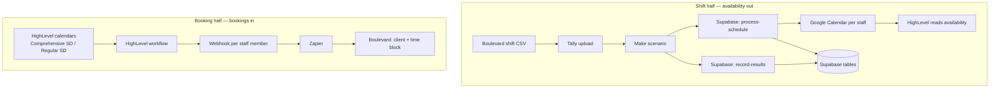

# PLAN — Sage & Vine (Midlothian) Staff-Schedule Automation

## Overview

This rebuilds the two-way scheduling sync between **Boulevard**, **Google Calendar**,
**HighLevel**, **Make**, and **Zapier** on a clean slate (new Supabase project
`ifiurgmzizyhnhrbvpho`). There are two independent halves that together keep staff
availability and client bookings in sync.

- **Shift half (availability out):** A Boulevard shift CSV is uploaded through a Tally
  form, which triggers a Make scenario. Make calls Supabase edge functions that compute
  out-of-office (OOO) blocks for every staff member and write them onto each person's
  Google Calendar. HighLevel reads availability from those same calendars, so blocking a
  calendar automatically closes that slot in HighLevel.
- **Booking half (bookings in):** When an appointment changes status on the HighLevel
  "Comprehensive SD" or "Regular SD" calendars, a HighLevel workflow fires a webhook (one
  per staff member) into Zapier, which creates the matching Boulevard client and time
  block.

Design rules baked in throughout:

- Staff are **read from the `employees` table filtered by `location_id`** — never
  hardcoded.
- A day with **no CSV row** for a staff member means that person is **OFF** that day — the
  whole working day is blocked as OOO.
- Time zone is **America/New_York**.
- A **15-minute threshold** is applied — shift/gap differences shorter than 15 minutes are
  ignored (no micro-blocks).
- Never schedule more than **365 days ahead**.
- A **delay is inserted between Google Calendar API calls** to avoid rate limiting.

### Data-flow diagram

```
SHIFT HALF (availability out)
─────────────────────────────
Boulevard shift CSV
      │  (export)
      ▼
Tally form upload ──► Make scenario ──► Supabase edge functions
                                              │  process-schedule
                                              │   • read employees (by location_id)
                                              │   • read store_hours
                                              │   • compute OOO blocks (off-day = full day)
                                              │   • write ooo_events rows
                                              ▼
                                        Google Calendar (per staff)
                                              │  OOO / busy events
                                              ▼
                                        HighLevel  ◄── reads availability
                                              │
                                        record-results  ◄── Make reports run outcome
                                              │  updates upload_batches + ooo_events
                                              ▼
                                           Supabase


BOOKING HALF (bookings in)
──────────────────────────
HighLevel calendars ("Comprehensive SD" / "Regular SD")
      │  appointment status change
      ▼
HighLevel workflow ──► webhook (one per staff member) ──► Zapier
                                                             │
                                                             ▼
                                                  Boulevard: create client
                                                           + create time block
```



> Note: the old Make scenario `SA_csv_upload` has been captured — Viktor pulled it from
> the public share (`https://us2.make.com/public/shared-scenario/0OQdrBfKtpS/sa-csv-upload`)
> and wrote the module breakdown to `docs/old-make-scenario.md`. The Make section below is
> rebuilt from that doc (its live contract + the bugs it had).

---

## Supabase

Core data store plus the two edge functions that do the OOO computation and reconciliation.

| Component/Step | What gets built | Status | Needed from Daniel |
| --- | --- | --- | --- |
| Project | New project `ifiurgmzizyhnhrbvpho` (old `chhhhfoljntqzeixnpzv` untouched) | Provisioned, nothing deployed | Supabase access token added as a **secret** (never in Slack) |
| Migration `0001_init.sql` | Tables `employees`, `store_hours`, `upload_batches`, `ooo_events` with `location_id`, indexes, comments | Written (scaffold) | Confirm column set; decide RLS/auth model |
| Migration `0002_service_mapping_and_seed.sql` | Adds `employees.regular_sd` / `comprehensive`, `ooo_events.location_id` (for idempotent re-uploads), seeds the 4 Midlothian practitioners **at location `SV00002`** and seeds `store_hours` for `SV00002` | Written (scaffold) | Confirm service mapping; see seed caveats below |
| `employees` seed | 4 practitioners (Cara Frey, Taylor, Nikki Gooding, Moriah Sedlak) with service mapping, **placeholder** calendar IDs, Midlothian location `SV00002` | Seeded in `0002` (partial) | **Real** Google calendar ID per staff; **Taylor's exact Boulevard ID (Cesena vs Earley)**; confirm carried-over Boulevard IDs match Midlothian |
| `store_hours` seed | Open/close per day-of-week for `SV00002` (Sun 9–5, Mon–Thu 9–8, Fri 9:30–8, Sat 9–5; plain weekly schedule; **no** holiday/Thanksgiving special-casing — not needed, launch is after Thanksgiving) | Seeded in `0002` | — (times confirmed by Daniel 2026-11-22) |
| `process-schedule` fn | Parses the **raw Boulevard CSV**, computes OOO blocks (off-day = full day, split shifts, "Unavailable" days, CSV-range-bounded), writes new `ooo_events` as pending, returns a per-employee `{events_to_create, events_to_delete}` plan. **Does NO Google calls** — Make performs them (task 7 contract). Creates the `upload_batches` row. | Implemented | Confirm exact Boulevard CSV column headers against a real export |
| `record-results` fn | Finalizes `upload_batches`; reconciles `ooo_events` from Make's `created[]`/`deleted[]` (pending→created with google_event_id, superseded→deleted) | Implemented | — |
| RLS policies | Row-level security | Deferred until auth model decided | Decide who calls functions (service role vs. authed) |

## Make

Orchestrates the upload → Supabase call and performs all Google Calendar writes.
Rebuilt from the old `SA_csv_upload` scenario (see `docs/old-make-scenario.md`), but
with the per-staff router replaced by a single dynamic calendar path.

**Module flow (new build):**

1. **Tally** `watchNewResponse` — new shift-CSV submission.
2. **HTTP DownloadFile** — fetch the uploaded CSV file field.
3. **Set variable** `csvText = toString(file)`.
4. **Create JSON** — `{ csv: csvText, cutoff_date, uploaded_by_name, uploaded_by_email,
   location_id }` (the Midlothian location id is a fixed value in the scenario).
5. **HTTP POST `process-schedule`** — raw CSV in, with a long timeout (old scenario
   used 180s). The function parses the CSV and returns `{ batch_id, employees[] }`,
   each employee carrying `google_calendar_id`, `events_to_create[] {ooo_event_id,
   start_at, end_at}` and `events_to_delete[] {ooo_event_id, google_event_id}`.
6. **Iterator** over `data.employees[]`.
7. **ONE dynamic calendar path — no per-staff router / branches:**
   - Iterate `events_to_create`, then Google Calendar `createAnEvent` on
     **`calendar = {{employee.google_calendar_id}}`** (summary e.g.
     "{{employee.employee_name}} OOO", busy/opaque). **Sleep 1s after every create.**
     Aggregate `{ ooo_event_id, google_event_id }`.
   - Iterate `events_to_delete`, then Google Calendar `deleteAnEvent` on the same
     dynamic `{{employee.google_calendar_id}}`. **Sleep 1s after every delete.**
     Aggregate `{ ooo_event_id }`.
8. **Create JSON** `{ batch_id, created[], deleted[] }`, then **POST `record-results`**.

**Settings:** turn **"store incomplete executions" ON** (so a partial run can be
resumed / inspected). Each staff Google calendar is shared ("make changes") with the
single Google account connected in Make, so the one dynamic path can write to all of
them.

**Bugs from the old scenario that this eliminates:**
- The old **Moriah branch had no condition**, so Make's first-match routing dumped
  every non-Cara/Lexi staffer's blocks onto **Moriah's calendar**. The single dynamic
  `{{employee.google_calendar_id}}` path removes the router entirely, so that can't
  happen.
- The old 1s sleep existed only on some branches (Lexi/Nikki); here it is on **every**
  create and delete.
- Adding a staff member no longer means adding a Make branch — it's just a new
  `employees` row with a `google_calendar_id`.

| Component/Step | What gets built | Status | Needed from Daniel |
| --- | --- | --- | --- |
| Trigger | Watch Tally submission (new shift CSV) | Not started | Tally form + webhook URL |
| Download + build JSON | DownloadFile → `csvText` → `{csv, cutoff_date, uploaded_by_*, location_id}` | Not started | Midlothian location ID |
| Call `process-schedule` | POST the **raw CSV** JSON; receive `{batch_id, employees[]}` | Not started | Deployed function URL + anon/service key (secret) |
| Dynamic Google path | Single create + single delete path on `{{employee.google_calendar_id}}`, 1s sleep after each call, "store incomplete executions" on | Not started | Google account connected in Make with "make changes" on every staff calendar |
| Call `record-results` | POST `{batch_id, created[], deleted[]}` to finalize | Not started | — |
| Error handling | Retry/alert on failure | Not started | Preferred alert channel |

## Tally

Front door for uploading the shift CSV.

| Component/Step | What gets built | Status | Needed from Daniel |
| --- | --- | --- | --- |
| Upload form | Tally form with file upload for the Boulevard shift CSV | Not started | Who uploads + any extra fields (location, week) |
| Webhook | Tally → Make webhook on submit | Not started | Connect once Make scenario exists |
| Validation | Basic file-type/format guardrails | Not started | Confirm expected CSV format |

## HighLevel

Reads availability (shift half) and triggers bookings (booking half).

| Component/Step | What gets built | Status | Needed from Daniel |
| --- | --- | --- | --- |
| Calendar read | Staff calendars connected so HighLevel reads OOO/busy from Google | Not started | Per-staff Google calendar IDs |
| Trigger calendars | Workflow triggers on appointment status for "Comprehensive SD" / "Regular SD" | Not started | Confirm which HighLevel calendars to use |
| Workflow | On status change → fire webhook (one per staff member) → Zapier | Not started | HighLevel user/calendar IDs per staff |
| Field mapping | Map appointment → client + time-block fields | Not started | Field mapping confirmation |

## Zapier

Turns HighLevel webhooks into Boulevard clients + time blocks (booking half).

| Component/Step | What gets built | Status | Needed from Daniel |
| --- | --- | --- | --- |
| Catch webhook | One Zap (or path) per staff member catching the HighLevel webhook | Not started | Webhook payload shape |
| Create client | Boulevard "create client" step | Not started | Boulevard API credentials/connection |
| Create time block | Boulevard "create time block" step for the staff member | Not started | Boulevard staff IDs per member |
| Reference | Rebuild from the live Zap | Blocked | **Screenshots of the live Zap** |

---

## Open questions / risks

- **CSV format — PARSER IS A BEST GUESS (blocker).** `process-schedule` now parses the raw
  Boulevard CSV itself. With no sample export available, the parser fuzzy-matches column
  headers (staff name / staff id / date / start / end / an availability-or-status column) and
  normalizes `YYYY-MM-DD` + `M/D/YYYY` dates and 12h/24h times. **The exact Boulevard column
  headers, staff identifier (name vs. Boulevard ID), and date/time formats must be confirmed
  against a real export** — see the `// TODO: confirm exact Boulevard CSV column headers`
  comment at the parsing boundary in `process-schedule/index.ts`.
- **Off-day definition.** Rules now implemented: no CSV row = OFF = block the whole working day
  (only within the CSV's own date range); a Boulevard "Unavailable" / full-day (12:00AM–11:59PM)
  row is also treated as OFF; split shifts block every non-working gap (open→first, between
  shifts, last→close). Still need to confirm "working day" = store open→close, and **which CSV
  column carries the "Unavailable" marker** (currently any availability/status/type/service/label/notes column is matched).
- **Store hours (seeded — Fix 8).** The `store_hours` table is a plain weekly open/close
  schedule per day-of-week, now seeded in `0002` for location `SV00002` from Daniel's hours
  (2026-11-22): Sun 9AM–5PM, Mon–Thu 9AM–8PM, Fri 9:30AM–8PM, Sat 9AM–5PM. Per Daniel,
  **no holiday / Thanksgiving special-casing is required** for launch (launch is after
  Thanksgiving), so no holiday logic is built.
- **Practitioners + service mapping (partial).** The 4 Midlothian practitioners and their service
  mapping (`regular_sd` / `comprehensive`) are provided and seeded in `0002`. Still open: Taylor's
  exact Boulevard ID (Cesena vs Earley), confirmation the carried-over Boulevard IDs match at
  Midlothian, the **real** Google calendar IDs (currently placeholders), the Supabase service-role
  key (as a secret), and the Make blueprint/scenario export.
- **Google Calendar auth lives in Make, not Supabase.** Per the old contract (task 7),
  `process-schedule` does NO Google calls — Make holds the single Google connection and
  performs every create/delete on `{{employee.google_calendar_id}}`. So the function needs no
  Google credentials. Open item: each staff calendar must be shared ("make changes") with
  Make's one Google account.
- **Rate limits.** Make sleeps 1s after every Google create and delete (on every path now, not
  just some branches as in the old scenario); tune if large staff counts / long windows trip
  quotas (365 days × staff × blocks).
- **Idempotency / re-uploads.** Implemented: `process-schedule` reads this location's existing
  **future** `ooo_events` within the CSV's date range (status `created`, with a `google_event_id`;
  scoped via `ooo_events.location_id`) and returns them as `events_to_delete`. Make deletes those
  Google events and `record-results` marks the rows `deleted`, so a re-upload cleanly replaces old
  blocks. Past events and other locations are untouched.
- **Time zone + DST.** All date math stays in America/New_York; `start_at`/`end_at` carry an
  explicit resolved UTC offset (−05:00/−04:00) so Make/Google get the right instant.
- **RLS deferred.** Until the auth model is set, the functions assume the service-role key;
  that key must stay a secret and never be exposed to Tally/Make clients directly.
- **Zap rebuild blocked** on live-Zap screenshots.
