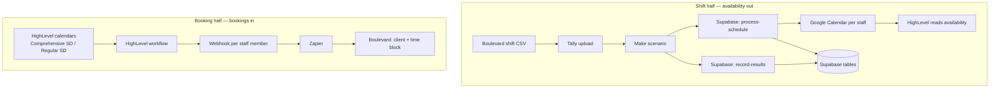

# PLAN — Sage & Vine (Midlothian) Staff-Schedule Automation

## Overview

This rebuilds the two-way scheduling sync between **Boulevard**, **Google Calendar**,
**HighLevel**, **Make**, and **Zapier** on a clean slate (new Supabase project
`ifiurgmzizyhnhrbvpho`). There are two independent halves that together keep staff
availability and client bookings in sync.

- **Shift half (availability out):** A Boulevard shift CSV is uploaded through a Tally
  form, which triggers a Make scenario. Make calls Supabase edge functions that compute
  out-of-office (OOO) blocks for every staff member and write them onto each person's
  Google Calendar. HighLevel reads availability from those same calendars, so blocking a
  calendar automatically closes that slot in HighLevel.
- **Booking half (bookings in):** When an appointment changes status on the HighLevel
  "Comprehensive SD" or "Regular SD" calendars, a HighLevel workflow fires a webhook (one
  per staff member) into Zapier, which creates the matching Boulevard client and time
  block.

Design rules baked in throughout:

- Staff are **read from the `employees` table filtered by `location_id`** — never
  hardcoded.
- A day with **no CSV row** for a staff member means that person is **OFF** that day — the
  whole working day is blocked as OOO.
- Time zone is **America/New_York**.
- A **15-minute threshold** is applied — shift/gap differences shorter than 15 minutes are
  ignored (no micro-blocks).
- Never schedule more than **365 days ahead**.
- A **delay is inserted between Google Calendar API calls** to avoid rate limiting.

### Data-flow diagram

```
SHIFT HALF (availability out)
─────────────────────────────
Boulevard shift CSV
      │  (export)
      ▼
Tally form upload ──► Make scenario ──► Supabase edge functions
                                              │  process-schedule
                                              │   • read employees (by location_id)
                                              │   • read store_hours
                                              │   • compute OOO blocks (off-day = full day)
                                              │   • write ooo_events rows
                                              ▼
                                        Google Calendar (per staff)
                                              │  OOO / busy events
                                              ▼
                                        HighLevel  ◄── reads availability
                                              │
                                        record-results  ◄── Make reports run outcome
                                              │  updates upload_batches + ooo_events
                                              ▼
                                           Supabase


BOOKING HALF (bookings in)
──────────────────────────
HighLevel calendars ("Comprehensive SD" / "Regular SD")
      │  appointment status change
      ▼
HighLevel workflow ──► webhook (one per staff member) ──► Zapier
                                                             │
                                                             ▼
                                                  Boulevard: create client
                                                           + create time block
```



> Note: the public copy of the old Make scenario
> (`https://us2.make.com/public/shared-scenario/0OQdrBfKtpS/sa-csv-upload`) could **not**
> be fetched from this cloud session — `us2.make.com` is outside the session's allowed
> network domains. It must be allowlisted in the session's network settings (or a
> screenshot/export shared) before its module list can be mirrored here. The Make section
> below is written from the known data flow, not from the live scenario.

---

## Supabase

Core data store plus the two edge functions that do the OOO computation and reconciliation.

| Component/Step | What gets built | Status | Needed from Daniel |
| --- | --- | --- | --- |
| Project | New project `ifiurgmzizyhnhrbvpho` (old `chhhhfoljntqzeixnpzv` untouched) | Provisioned, nothing deployed | Supabase access token added as a **secret** (never in Slack) |
| Migration `0001_init.sql` | Tables `employees`, `store_hours`, `upload_batches`, `ooo_events` with `location_id`, indexes, comments | Written (scaffold) | Confirm column set; decide RLS/auth model |
| Migration `0002_service_mapping_and_seed.sql` | Adds `employees.regular_sd` / `comprehensive`, `ooo_events.location_id` (for idempotent re-uploads), seeds the 4 Midlothian practitioners | Written (scaffold) | Confirm service mapping; see seed caveats below |
| `employees` seed | 4 practitioners (Cara Frey, Taylor, Nikki Gooding, Moriah Sedlak) with service mapping, **placeholder** calendar IDs, Midlothian location | Seeded in `0002` (partial) | **Real** Google calendar ID per staff; **Taylor's exact Boulevard ID (Cesena vs Earley)**; confirm carried-over Boulevard IDs match Midlothian |
| `store_hours` seed | Open/close per day-of-week for the location | Not started | Midlothian store hours |
| `process-schedule` fn | Computes OOO blocks (off-day = full day, split shifts, "Unavailable" days, CSV-range-bounded), idempotent re-uploads (deletes superseded future OOO), writes `ooo_events`, pushes to Google Calendar with delay | Scaffold (TODOs for Google auth) | Google service-account / OAuth for Calendar API |
| `record-results` fn | Updates `upload_batches` status + reconciles `ooo_events` | Scaffold | — |
| RLS policies | Row-level security | Deferred until auth model decided | Decide who calls functions (service role vs. authed) |

## Make

Orchestrates the upload → Supabase call. Replaces the old scenario on a clean build.

| Component/Step | What gets built | Status | Needed from Daniel |
| --- | --- | --- | --- |
| Trigger | Watch Tally submission (new shift CSV) | Not started | Tally form + webhook URL |
| Parse CSV | Parse Boulevard shift CSV into rows (staff id, date, start, end) | Not started | Sample CSV + column names/format |
| Create batch | Insert `upload_batches` row (location_id, filename) | Not started | Midlothian location ID |
| Call `process-schedule` | POST batch_id + parsed rows to the edge function | Not started | Deployed function URL + service key (secret) |
| Call `record-results` | Report run outcome back to Supabase | Not started | — |
| Error handling | Retry/alert on failure | Not started | Preferred alert channel |
| Reference | Mirror modules from old scenario | Blocked | Allowlist `us2.make.com` or share scenario export/screenshots |

## Tally

Front door for uploading the shift CSV.

| Component/Step | What gets built | Status | Needed from Daniel |
| --- | --- | --- | --- |
| Upload form | Tally form with file upload for the Boulevard shift CSV | Not started | Who uploads + any extra fields (location, week) |
| Webhook | Tally → Make webhook on submit | Not started | Connect once Make scenario exists |
| Validation | Basic file-type/format guardrails | Not started | Confirm expected CSV format |

## HighLevel

Reads availability (shift half) and triggers bookings (booking half).

| Component/Step | What gets built | Status | Needed from Daniel |
| --- | --- | --- | --- |
| Calendar read | Staff calendars connected so HighLevel reads OOO/busy from Google | Not started | Per-staff Google calendar IDs |
| Trigger calendars | Workflow triggers on appointment status for "Comprehensive SD" / "Regular SD" | Not started | Confirm which HighLevel calendars to use |
| Workflow | On status change → fire webhook (one per staff member) → Zapier | Not started | HighLevel user/calendar IDs per staff |
| Field mapping | Map appointment → client + time-block fields | Not started | Field mapping confirmation |

## Zapier

Turns HighLevel webhooks into Boulevard clients + time blocks (booking half).

| Component/Step | What gets built | Status | Needed from Daniel |
| --- | --- | --- | --- |
| Catch webhook | One Zap (or path) per staff member catching the HighLevel webhook | Not started | Webhook payload shape |
| Create client | Boulevard "create client" step | Not started | Boulevard API credentials/connection |
| Create time block | Boulevard "create time block" step for the staff member | Not started | Boulevard staff IDs per member |
| Reference | Rebuild from the live Zap | Blocked | **Screenshots of the live Zap** |

---

## Open questions / risks

- **CSV format unknown.** Column names, staff identifier (name vs. Boulevard ID), date and
  time formats all drive the parser and the employee match. Need a sample file.
- **Off-day definition.** Rules now implemented: no CSV row = OFF = block the whole working day
  (only within the CSV's own date range); a Boulevard "Unavailable" / full-day (12:00AM–11:59PM)
  row is also treated as OFF; split shifts block every non-working gap (open→first, between
  shifts, last→close). Still need to confirm "working day" = store open→close, and **which CSV
  column carries the "Unavailable" marker** (currently any of label/type/service/notes is matched).
- **Practitioners + service mapping (partial).** The 4 Midlothian practitioners and their service
  mapping (`regular_sd` / `comprehensive`) are provided and seeded in `0002`. Still open: Taylor's
  exact Boulevard ID (Cesena vs Earley), confirmation the carried-over Boulevard IDs match at
  Midlothian, the **real** Google calendar IDs (currently placeholders), the Supabase service-role
  key (as a secret), and the Make blueprint/scenario export.
- **Google Calendar auth.** Service account (domain-wide delegation) vs. per-user OAuth is
  undecided; it changes how `createGoogleOOOEvent` authenticates and how calendars are
  shared.
- **Rate limits.** A 250 ms delay between Google calls is a starting point; may need tuning
  for large staff counts / long planning windows (365 days × staff × blocks).
- **Idempotency / re-uploads.** Implemented: before inserting, `process-schedule` deletes this
  location's existing **future** OOO events within the CSV's date range from both Google Calendar
  and `ooo_events` (scoped via the new `ooo_events.location_id`), so a re-upload cleanly replaces
  old blocks. Past events and other locations are untouched.
- **Time zone + DST.** All date math must stay in America/New_York; naive UTC math would
  drift across DST boundaries.
- **Make scenario reference blocked** until `us2.make.com` is allowlisted or an export is
  shared.
- **RLS deferred.** Until the auth model is set, the functions assume the service-role key;
  that key must stay a secret and never be exposed to Tally/Make clients directly.
- **Zap rebuild blocked** on live-Zap screenshots.
